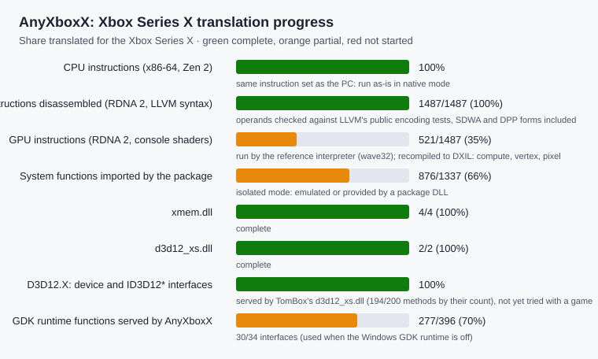

> English: [progress.md](../progress.md)

# Avancée et banc d'essai

Mesures du 21 novembre 2026. Pour les reproduire : `python PrototypeScarlett/scarlett.py --banc <dossier>`.

## Mesures du jeu (VIctory, build Xbox Series 1.0.2.1)

Ce sont les essais qui figuraient autrefois dans l'encadré du README. Les chiffres sont ceux rapportés par le mainteneur à partir des journaux de VIctory, sauf mention « observé » (jugement du mainteneur sur l'image) ou « lu dans le journal » (notre analyse). Chacun vaut pour l'épingle indiquée, qui n'est plus la base actuelle.

- 24 nov., `d279e69` : environ 4 fps ; 13 minutes en prison, puis une perte de périphérique.
- 24 nov., `7b0f736` avec `VICTORY_RELAY=2` : environ 4,5 fps.
- 24 nov., réglages du lanceur de la PR #172 sans DRED : environ 5,5 fps. Lot 4 (trois pull requests) avec `VICTORY_RELAY=2` : environ 6,6 fps, scintillement au démarrage corrigé.
- 24 nov., lot 8 (`d138351`, puis `19feca8`) : 4,8 à 5,4 fps, environ 6 550 dessins par image, shaders du cache d'irradiance traduits. Avec la bibliothèque de disposition des textures de Microsoft (`-XgDll`) : 5,4 à 7,1 fps, contre 5,1 à 5,6 sans.
- 25 nov., `80d58f8` : 5,3 à 6,9 fps depuis une nouvelle sauvegarde jusqu'au monde, pas de perte de périphérique ; cinématiques complètes (observé).
- 25 nov., base Neptune (2026-11-25c), Windows 11, RTX 4070 SUPER, i7-13700KF : médiane de 13,8 fps dans le monde, 15,6 à 17 fps sur la dernière minute, 72,5 ms par image. Avec `-Quality` : 7 à 9 fps, 51 à 93 refus de textures contre environ 300.
- 25 nov., Proton (GE-Proton11-12), Fedora 44, RX 9070 XT : médiane de 3,7 fps sur environ 23 minutes, aucun plantage. Les zones à l'ombre et en intérieur restent noires.
- 26 nov., matin : médiane de 13,4 fps. 26 nov., après-midi : médiane de 16 à 17 fps sur la même machine, après #358 (copies), #386 (trois options de fxceless, +17 % en test A/B) et #394 (balayage du tas, +7 % et quatre fois moins d'à-coups).

Le goulot est le processeur, pas la carte graphique : ce sont les copies et les relectures qui émulent la mémoire unifiée de la console. Le chantier mémoire unifiée est en cours. Mesuré sans dessin, le seul code du jeu tient 30 fps.

## Méthode

Le banc charge chaque module PE d'un dossier, lance ses callbacks TLS puis `DllMain(base, DLL_PROCESS_ATTACH, 0)`. Un module est **initialisé** quand `DllMain` renvoie `TRUE`. Le banc ne copie aucun fichier dans le dépôt : seuls les noms des modules et les mesures sont publiés.

Cas de test utilisés :

1. `PrototypeScarlett/demo.pe`, la démo libre du projet.
2. Les 16 DLL d'exécution d'un paquet GDK Scarlett du commerce présent sur la machine de développement. L'exécutable principal du jeu est absent du paquet : seul le démarrage des bibliothèques est testé.

## Résultats sur les 16 DLL

| Version | Modules chargés | `DllMain` réussi | Imports résolus | Appels non émulés |
|---|---|---|---|---|
| Première version (un seul import GDK accepté) | 0/16 | 0/16 | 1 fonction | — |
| Couche HLE, première passe | 16/16 | 4/16 | non mesuré | — |
| Ajout de `_initialize_onexit_table`, `IsProcessorFeaturePresent`, locale, maths | 16/16 | 16/16 | 523/1337 (39 %) | 7 |
| Plusieurs modules liés : chaque DLL charge ses dépendances du paquet | 16/16 | 16/16 | 782/1337 (58 %) | 0 |
| Démarrage d'un `.exe`, texte du CRT, événements, interface GDK PC | 16/16 | 16/16 | 871/1337 (65 %) | 0 |
| `xmem.dll` émulée (`XMemAlloc`, `XMemFree`…) | 16/16 | **16/16** | **876/1337 (66 %)** | **0** |

Un import est **résolu** quand il pointe vers une fonction émulée en Python ou vers l'export d'une autre DLL du paquet. Depuis le chargement multi-modules, `msvcp140.dll` tourne avec le vrai `vcruntime140.dll` du paquet, et `concrt140.dll` avec le vrai `msvcp140.dll`.

Fonctions qui ont débloqué le plus de modules :

| Fonction | Effet |
|---|---|
| `_initialize_onexit_table` | 12 DLL échouaient dans l'initialisation du CRT |
| `IsProcessorFeaturePresent` | 128 appels par passe : annonce SSE à SSE4.2 (le processeur émulé n'a pas AVX2) |
| `setlocale`, `__pctype_func`, `___lc_locale_name_func` | `msvcp140.dll` lisait un code d'erreur comme un pointeur |
| `exp`, `log`, `floor` (XMM0) | premières fonctions à argument flottant |

| `RtlPcToFileHeader`, `GetProcAddress`, `RegisterTraceGuidsW`, `___mb_cur_max_func` | derniers appels manquants des DLL liées |

Plus aucun appel non émulé pendant l'initialisation des 16 DLL. Les prochains manques apparaîtront quand le code du jeu lui-même s'exécutera.

## Traduction des DLL console

Mesure : `python PrototypeScarlett/scarlett.py --traduction <dossier du paquet> docs/images/traduction.svg`. Les DLL du paquet n'importent que deux bibliothèques propres à la console :

| DLL | Fonctions importées | Traduction (runtime C++, `runtime/`) |
|---|---|---|
| `xmem.dll` | `XMemAlloc`, `XMemFree`, `XMemVirtualQuery`, `XMemGetWorkingSetStatistics` | Attributs `XALLOC_ATTRIBUTES` décodés avec la disposition ERA (portée de Xbox2Windows) : tas du PC à l'alignement demandé (64 octets au moins, 4 Kio pour les gros blocs), types graphiques dans leur propre région de pages, mémoire physique refusée ; crochets d'allocation ; `XMemVirtualQuery(processus, adresse, tampon)` avec un drapeau de mémoire graphique à +0x30 (politique du PC, champ non confirmé). Les statistiques renvoient un échec propre : leur structure n'est pas publique. |
| `d3d12_xs.dll` | `D3D12SerializeVersionedRootSignature`, `D3D12CreateRootSignatureDeserializer` | Redirigées vers le `d3d12.dll` du PC : même contrat, structures publiques. |

Le runtime C++ est préchargé par son chemin complet. Windows retrouve ensuite ces DLL par leur nom : une DLL du jeu chargée par Windows lui-même reçoit aussi celles d'AnyXboxX.

L'exécutable principal du jeu est absent du paquet. Ses propres imports console, notamment la création du périphérique D3D12.X, s'ajouteront à cette liste.

## Runtime GDK : table des interfaces

Sur PC, chaque fonction `X*` de la bibliothèque statique du GDK (`xgameruntime.lib`) appelle `QueryApiImpl(&fournisseur, &interface, &objet)`, puis une méthode de l'objet, de type COM : 0 `QueryInterface`, 1 `AddRef`, 2 `Release`, puis les API. Chaque méthode reçoit `this`, suivi des arguments de la fonction publique.

`python tools/gdk_interfaces.py` relit le désassemblage de la bibliothèque et produit `runtime/xgameruntime/gdk_api_table.inc` : **396 fonctions réparties sur 34 interfaces** pour le GDK 2610. Les plus grosses :

| Interface | Fonctions | Servie par |
|---|---|---|
| `XStore` (+ 3 versions d'interface) | 70 | **AnyXboxX** (licence locale, produits vides, achat et téléchargement hors ligne) |
| `XGameUi` | 42 | Windows |
| `XUser` (+ 4 versions d'interface, `XUserGetGamertag`) | 44 | **AnyXboxX** (profil hors ligne) |
| `XGameStreaming` | 32 | **AnyXboxX** (aucun client de streaming : les questions sur un client répondent `E_GAMESTREAMING_CLIENT_NOT_CONNECTED`) |
| `XPackage` | 31 | Windows |
| `XGameSave` (+ `XGameSaveFiles`) | 30 | **AnyXboxX** (disque du PC) |
| `XTaskQueue` / `XAsync` / `XThread` | 27 | **AnyXboxX** |

## Identité Xbox Series X

`XSystemGetDeviceType` n'est pas une interface : `xgameruntime.lib`, lié dans le jeu, lit `HKLM\Software\Microsoft\Windows NT\CurrentVersion\OEM`, valeur `ConsoleMode`. La valeur 0x64 donne `XboxScarlettAnaconda`, et l'absence de valeur donne `Pc`. En mode natif, AnyXboxX redirige les fonctions de registre du jeu **et des DLL de son dossier** vers un registre simulé (`runtime/xgameruntime/registry.cpp`) : seule cette clé est simulée, le reste va au vrai registre.

`XGameGetXboxTitleId` renvoie le `<TitleId>` du `MicrosoftGame.config` du jeu. `XSystemGetAnalyticsInfo` annonce la famille « Windows.Xbox » et le modèle « Xbox Series X », et le bac à sable Xbox Live est `RETAIL`.

## Sauvegardes

`XGameSave` et `XPersistentLocalStorage` écrivent sur le disque du PC, dans `%LOCALAPPDATA%\AnyXboxX\<TitleId>\` (ou `ANYXBOXX_SAVE_DIR`). L'organisation est `saves\<configuration>\<XUID>\<conteneur>\<blob>.blob`. Les noms du jeu sont encodés en `%XX` pour tout caractère hors `[A-Za-z0-9_-]` : aucun nom ne peut sortir du dossier. Chaque blob est écrit dans un fichier temporaire puis renommé, ce qui évite les sauvegardes à moitié écrites. Le quota simulé est de 256 Mio par configuration ; il n'y a pas de synchronisation cloud. Le stockage local annonce la taille du `<PersistentLocalStorage><SizeMB>` du `MicrosoftGame.config`.

`runtime/xgameruntime/served_interfaces.inc` liste les interfaces servies par AnyXboxX. Ce fichier est lu à la fois par le C++ et par la mesure `--traduction`.

## Exécution native

Depuis le 21 novembre 2026, `--natif` charge un exécutable et le lance directement sur le processeur (approche Wine). Premier résultat : le jeu de test **SimpleTriangle s'affiche**, avec le runtime GDK servi par AnyXboxX. Détails, captures et limites : [jeu-de-test.md](jeu-de-test.md).

## Chargement multi-modules

Ordre de résolution d'un import `dll!fonction` (`emu/modules.py`) :

1. DLL système (`kernel32`, `api-ms-win-*`, `xgameruntime`…) : toujours la couche HLE, même si un fichier du même nom est dans le paquet.
2. DLL présente dans le dossier du paquet : chargée comme module, l'import pointe vers son export. Les ordinaux et les redirections (`DLL.Fonction`) sont suivis.
3. Sinon : entrée HLE, ou `E_NOTIMPL` si la fonction n'est pas émulée.

Chaque module garde sa base préférée si elle est libre ; sinon il est relocalisé dans une zone dédiée (`0x6000_0000_0000`). Les dépendances sont initialisées avant le module qui les importe ; un `DllMain` qui renvoie `FALSE` annule le chargement, comme sous Windows.

## Limite connue

Une fonction absente renvoie `E_NOTIMPL` (`0x80004001`). C'est correct pour une fonction qui renvoie un `HRESULT`. Pour une fonction qui renvoie un `BOOL`, la valeur passe pour un succès ; pour un pointeur, elle provoque un accès mémoire invalide à `0x80004001`. Le journal nomme alors la fonction à émuler.

## Jeu libre pour les tests

Le jeu de test retenu est **SimpleTriangle** (`microsoft/Xbox-GDK-Samples`, licence MIT), compilé pour PC et comparé à son exécution native : voir [jeu-de-test.md](jeu-de-test.md). Aucun jeu libre n'existe en binaire Series X : la cible `Gaming.Xbox.Scarlett.x64` exige le GDKX, réservé aux studios sous accord de confidentialité.
